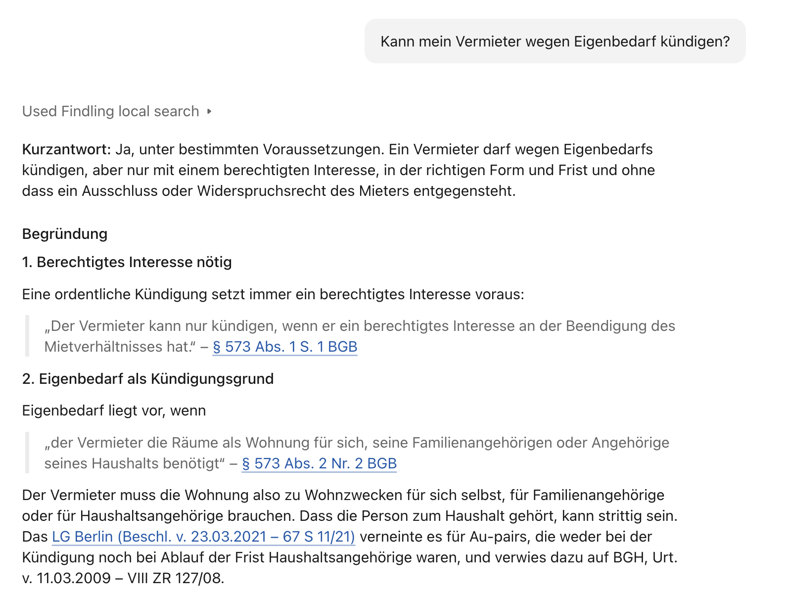
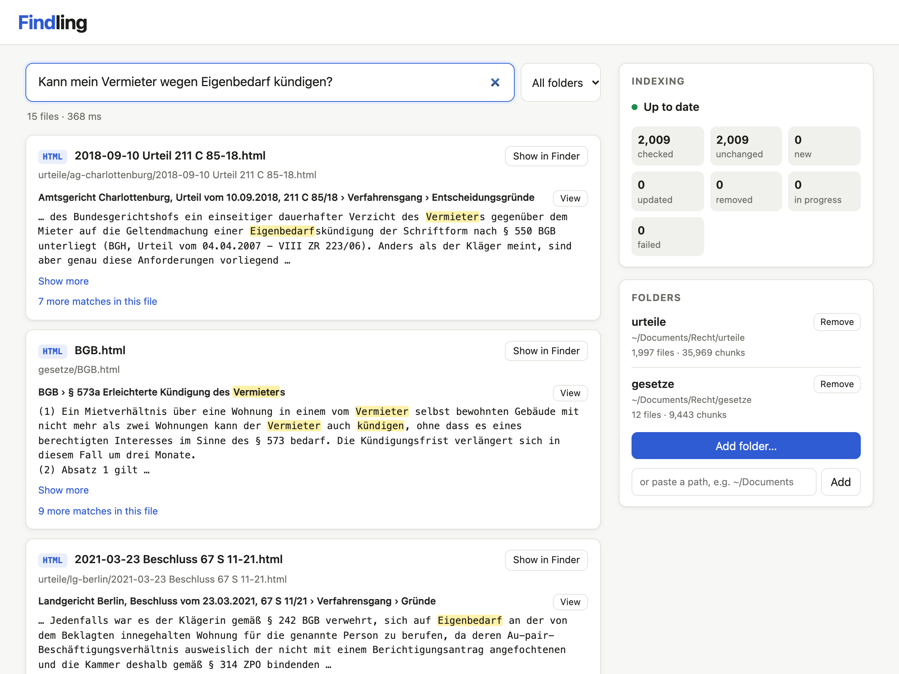

<div align="center">


# Findling

**Let your AI assistant search, read and cite your own files. Privately, on your own computer.**

[](https://github.com/cedricfauth/findling/actions/workflows/test.yml)
[](LICENSE)


[](https://modelcontextprotocol.io)

[Quick start](#quick-start) · [Connect your AI assistant](#connect-your-ai-assistant) · [Documentation](#documentation)

<br>

<table>
<tr>
<td width="50%"></td>
<td width="50%"></td>
</tr>
<tr>
<td align="center">Claude answering with quotes from my files</td>
<td align="center">The same question in Findling's search page</td>
</tr>
</table>

</div>

## Why Findling?

**Findling lets your AI assistant work with your own files.** Pick the folders you care
about (documents, PDFs, web pages, notes), then just ask your assistant, for example
Claude, a question. It searches those folders, reads the passages that matter and answers
with quotes and links back to the source, so you can check every claim with one click.
You don't need to know the exact words or where a file is: asking *how much notice do I
have to give on my flat?* finds the right clause in your rental contract, even if it
never uses the word "notice".

### Why not just upload the files to the chat?

That works for a handful of documents, but not for the folders you actually keep:

| | Uploading files to a chat | Findling |
|---|---|---|
| **How much** | A chat only holds so much: a few documents | Thousands of files across all your folders |
| **Finding the right file** | You pick the files before you ask | Findling finds them for you |
| **Answer quality** | The assistant wades through everything you uploaded on every question and can miss the one detail that matters | The assistant only reads the passages that are relevant |
| **Speed** | The more you upload, the slower the chat and the sooner it hits its limits | A search takes about a second, so the assistant can look things up as often as it needs |
| **Keeping up to date** | Upload again for every new chat and after every change | Findling notices new and changed files by itself |
| **Privacy** | Whole files leave your computer | Files stay on your computer; the assistant only sees the passages it needs |
| **Checking answers** | Hard to tell where in a file a quote came from | Every quote links to the exact spot, highlighted |

Findling also works on its own, as a search page in your browser: type what you're
looking for, see the matching passages, and open each file right at that spot,
highlighted.

## Features

- Finds by meaning and by exact words, in German, English and other languages, including
  IDs like `INV-2024-0042`
- Reads PDFs, Word, PowerPoint, Excel, web pages, Markdown, notes and code
- Watches your folders and only reprocesses what changed
- Runs only on your computer and doesn't accept connections from other devices

## Quick start

1. **Install [uv](https://docs.astral.sh/uv/)**, if you don't have it yet:
   ```bash
   curl -LsSf https://astral.sh/uv/install.sh | sh
   ```
2. **Install Findling:**
   ```bash
   uv tool install --python 3.12 git+https://github.com/cedricfauth/findling
   ```
3. **Connect your AI assistant** (see [below](#connect-your-ai-assistant)).
4. **Add your folders:** run `findling` (or let your assistant start it), open
   [http://127.0.0.1:8765](http://127.0.0.1:8765) and click **Add folder…**. Findling
   indexes them in the background.
5. **Ask your assistant** about your files.

To update, run step 2 again with `--force`.

## Connect your AI assistant

Findling is an [MCP](https://modelcontextprotocol.io) server, the open standard for
connecting AI assistants to tools. Your assistant gets four tools: `search`, `read` (read
on from a passage or open a section such as `§ 1599`), `browse` (folders, files,
sections) and `open` (show a passage in your browser).

**Claude Desktop (macOS):** download `findling.mcpb` from the
[latest release](https://github.com/cedricfauth/findling/releases/latest) and
double-click it. Claude then starts Findling in the background whenever it needs it.

**Claude Code:**

```bash
claude mcp add findling -- findling-mcp
```

**Other apps** that support MCP should work too. Most take a config like this (use the
full path that `which findling-mcp` shows; some apps name the outer key differently,
see their MCP docs):

```json
{
  "mcpServers": {
    "findling": { "command": "/Users/you/.local/bin/findling-mcp" }
  }
}
```

Like with Claude, the command starts Findling in the background when needed. Apps that
connect over HTTP instead can use `http://127.0.0.1:8765/mcp` while Findling runs. If an
app doesn't work with it, please open an issue.

Web chats such as claude.ai or ChatGPT in the browser can't reach Findling: it only
listens on your own computer. More details: [Using Findling](docs/usage.md#ai-agents-mcp).

[`examples/findling-recht`](examples/findling-recht/) is an example Claude skill for
German law that makes Claude ground its answers in indexed laws and court decisions and
cite every source. To make one for your own field, use
[`examples/findling-skill-creator`](examples/findling-skill-creator/): it studies your
indexed folders and writes the skill.

## Use it on its own

```bash
findling                                      # web app at http://127.0.0.1:8765
findling-search "how do I restore a backup"   # search from the terminal
```

## Platforms

| | Works | GPU for indexing | Claude Desktop |
|---|---|---|---|
| **macOS, Apple Silicon** | Yes | Automatic (untested) | Yes |
| **macOS, Intel** | Yes | No, CPU only | Yes |
| **Linux** | Yes | NVIDIA with an [extra install](docs/configuration.md#gpu) (untested) | Not available |
| **Windows** | Not yet | | |

## Status

Version 0.1.0, the first public release. Known limits:

- GPU indexing hasn't been tested on real hardware yet. If it causes trouble, set
  `FINDLING_DEVICE=cpu` and open an issue.
- Scanned PDFs and images yield no text (no OCR).
- No Windows support yet.

Ideas for later are in [docs/IMPROVEMENTS.md](docs/IMPROVEMENTS.md).

## Documentation

- [Using Findling](docs/usage.md): the web app, command-line search, and the MCP tools in detail
- [Configuration](docs/configuration.md): settings, folders, Linux, GPU, HTML pages and extensions
- [How it works](docs/how-it-works.md): parsing, embeddings, storage and how results are ranked
- [Development](docs/development.md): working on Findling, tests and releases

## License

Copyright (C) 2026 Cedric Fauth.

Findling is free software under the [GNU Affero General Public License v3.0 or later](LICENSE).
In short: you may use, change and share it, but whoever shares it, or lets others use a
changed version over a network, must make the source available under the same license.
For use in a closed product, a commercial license is available on request.

The bundled [pdf.js](https://mozilla.github.io/pdf.js/) viewer is licensed under the
Apache License 2.0.
